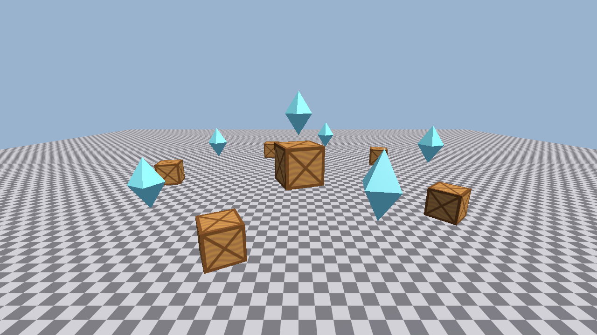

# basalt

A Vulkan powered game engine. **The executable is the engine, the game is a folder.**

```
basalt                  # runs ./game next to the exe (or in the current dir)
basalt path/to/mygame   # runs any game folder
```

Everything a game needs (config, levels, models, textures, Lua scripts, data)
lives in one folder. Ship a game by putting `basalt(.exe)` next to a `game/`
folder. Edit scripts, levels, models and textures while the game runs and
they hot reload; scripts can react to any other file through `on_file_changed`.



## Building

Needs a recent stable Rust toolchain. Everything else (Lua, etc.) builds from source.

```
cargo run --release              # runs the demo in ./game
cargo run --release -- my_game   # runs another game folder
cargo test
```

**Runtime requirements:** a GPU + driver with **Vulkan 1.3** (any current
NVIDIA/AMD/Intel driver on Windows or Linux). On Linux, X11 needs
`libxkbcommon-x11` (installed on basically every desktop).

**Shaders:** `build.rs` compiles `shaders/*.vert|frag` with `glslc` if it is on
your PATH (it ships with the Vulkan SDK). Without it, or if glslc fails while
the GLSL is unchanged (e.g. an old SDK), the committed SPIR-V in
`shaders/prebuilt/` is used. Each prebuilt file has a `.hash` of the GLSL it
came from, so the build warns loudly if your shader edits can't be compiled.
After editing shaders, run `BASALT_UPDATE_PREBUILT=1 cargo build` once to
refresh the prebuilt copies.

Debug builds enable the Vulkan validation layer if it is installed.
Override with `BASALT_VALIDATION=1` / `0`. More logging: `RUST_LOG=debug`.

## Game folder

```
game/
  game.json            required: title, window, start level
  levels/*.json        scenes: entities + lighting
  models/*.gltf|.glb   glTF 2.0 (+ .bin buffers)
  textures/*.png|.jpg  referenced by the models
  scripts/*.lua        entity scripts; require() resolves from here
  data/...             anything else, readable via game.read_file()
```

Only `game.json` is mandatory, the rest is convention. All paths are relative to
the game folder and can't escape it (`../` out of the folder is an error).

### game.json

```json
{
  "title": "My Game",
  "start_level": "levels/main.json",
  "window": { "width": 1280, "height": 720, "vsync": true, "resizable": true, "fullscreen": false },
  "hot_reload": true,
  "dev_mode": false,
  "script_timeout_ms": 1000
}
```

Every field is optional; the values above are the defaults (title aside).

### Levels

```json
{
  "environment": {
    "clear_color": [0.32, 0.45, 0.62, 1.0],
    "sun_direction": [-0.5, -1.0, -0.35],
    "sun_color": [1.0, 0.96, 0.88],
    "sun_intensity": 1.0,
    "ambient": [0.18, 0.2, 0.26]
  },
  "entities": [
    { "name": "camera", "position": [0, 3, 9], "rotation": [-15, 0, 0],
      "camera": { "fov": 70, "near": 0.1, "far": 500 },
      "script": "scripts/fly_camera.lua" },
    { "name": "crate", "model": "models/crate.gltf", "position": [0, 0.5, 0],
      "rotation": [0, 45, 0], "scale": 1.5,
      "script": "scripts/spinner.lua", "params": { "speed": 90 } }
  ]
}
```

Entity fields: `name`, `model`, `position`, `rotation` (Euler degrees
`[pitch, yaw, roll]`), `scale` (number or `[x, y, z]`), `visible`, `camera`,
`script`, `params` (any JSON, handed to the script as `self.params`).
Unknown fields are an error, so typos don't fail silently.

The first entity with a `camera` (in level-file order, then runtime spawns) is
the active camera; this stays the same across level reloads. Coordinates are
right-handed, Y up, -Z forward (same as glTF).

### Scripts

A script returns a table. Every entity using it gets its own instance (`self`)
that falls back to that table for functions.

```lua
local Spinner = {}

function Spinner:on_start()       -- first frame the entity is alive
  self.speed = self.params.speed or 90
end

function Spinner:on_update(dt)    -- every frame
  self.entity:rotate_y(self.speed * dt)
end

function Spinner:on_destroy() end -- entity destroyed or level unloaded
                                  -- (only if on_start ran)
function Spinner:on_reload() end  -- after hot reload; self state is kept
function Spinner:on_file_changed(path) end -- any file in the game folder
                                  -- was saved (game-relative path)

return Spinner
```

Instance fields: `self.entity`, `self.params`, `self.name`.

If `on_start` errors or destroys its own entity, `on_update` doesn't run.

A single script call (a hook, or a script file's top-level code) that runs
longer than `script_timeout_ms` (default 1000; `0` = no limit) is stopped with
an error and that script pauses, so an accidental infinite loop can't freeze
the game or block hot reload.

### Lua API

| | |
|---|---|
| **vec3** | `vec3(x, y, z)`, `vec3(s)`; fields `x y z`; `+ - * /` with vec3 or numbers; `:length() :normalized() :dot(v) :cross(v) :distance(v) :lerp(v, t) :copy() :unpack()` |
| **entity** | fields `name position rotation scale model visible` (read/write), `id`, `script_path`; methods `:valid() :destroy() :translate(v) :translate_local(v) :rotate(axis, deg) :rotate_local(axis, deg) :rotate_x/y/z(deg) :look_at(target, up?) :forward() :right() :up() :script()` |
| **scene** | `find(name) all() camera() spawn{...} load_level(path) reload_level() level() set_clear_color(r,g,b,a?) set_sun(dir, color?) set_ambient(color)` |
| **input** | `key_down/pressed/released(name) mouse_down/pressed/released("left"\|"right"\|"middle") mouse_position() mouse_delta() scroll() lock_cursor(bool) cursor_locked()`. The lock applies at the end of the frame; `cursor_locked()` reports whether it actually took effect. |
| **time** | `time.dt time.elapsed time.frame` |
| **game** | `quit() read_file(path) file_exists(path) list_dir(path) window_size() set_title(s)` |
| **json** | `decode(text) encode(value, pretty?)` |
| **log** | `info/warn/error/debug(...)`; `print` goes to `log.info` |

Key names: `a`–`z`, `0`–`9`, `f1`–`f12`, `space enter escape tab backspace
delete insert home end pageup pagedown left right up down`, `shift ctrl alt`
(either side) or `lshift rshift lctrl rctrl lalt ralt`, plus punctuation
(`-`, `=`, `[`, `]`, `;`, `'`, `,`, `.`, `/`, `\`). They're physical keys, so
`w` is the same spot on AZERTY.

Positions/rotations are returned as copies: `local p = e.position; p.y = 2;
e.position = p`. `scene.spawn` takes the same fields as a level entity
(`position` can be a `vec3` or `{x, y, z}`). Its `params` can be any Lua
value (vec3s, entity handles, functions), and the script instance exists right
away, so `scene.spawn{...}:script()` works immediately. `on_start` runs on
the next update.

`require` only loads modules from `scripts/`, whatever `package.path` says.

`io`, `debug`, `dofile`, `loadfile`, native modules and the dangerous `os`
functions are removed. This is a guard rail, not a security boundary: only run
game folders you trust.

### Hot reload

| You save... | What happens |
|---|---|
| a `.lua` file | every script recompiles and is swapped under live entities (state kept, `on_reload` called). Syntax error: the old version keeps running. Runtime error: that script pauses, and retries the next time any game file is saved (so fixing a data file it reads also un-pauses it). |
| the current level `.json` | level reloads. Broken JSON: the current level stays. |
| a model / texture | GPU caches flush and models reload |
| `game.json` | needs a restart (logged) |
| anything else (`data/*.json`, ...) | nothing automatic; every script's `on_file_changed(path)` is called so it can re-read what it needs (the demo's `main.lua` does this for `data/demo.json`) |

`on_file_changed` also fires for the cases above, after their reload.

### Hotkeys

- **Alt+Enter**: toggle fullscreen (always on)
- **F5**: reload the current level, only with `"dev_mode": true` in
  `game.json`. It's off by default so players of a shipped game can't wipe
  the level by accident, and games are free to bind F5 themselves.

## The demo

`game/` is a small demo: WASD to fly, hold right mouse or press Tab to look,
F / left click to throw crates, R to reload, Esc to quit. Its models and
textures are generated by `tools/gen_demo_assets.py` (stdlib Python).

## Code map

```
src/main.rs           finds the game folder, starts the app
src/app.rs            window + event loop, frame order, hot reload dispatch
src/vfs.rs            game folder paths (sandboxed)
src/config.rs         game.json
src/scene.rs          entities, transforms, level files
src/input.rs          keyboard/mouse state
src/hot_reload.rs     debounced file watcher
src/scripting/        Lua host, userdata types, global API
src/renderer/         Vulkan: context, swapchain, resources, glTF, frame loop
shaders/              GLSL (+ prebuilt SPIR-V)
```

## Not in v1 (yet)

PBR materials (only base color + texture), normal maps, shadows, alpha blending
(`BLEND` materials render alpha-tested; `OPAQUE`, `MASK` and `doubleSided`
are supported), skinned/animated meshes, audio, gamepads, physics, UI/text,
packaging the game folder into an archive. Models stream in on the main thread
the first time they're drawn, so big models hitch once.
